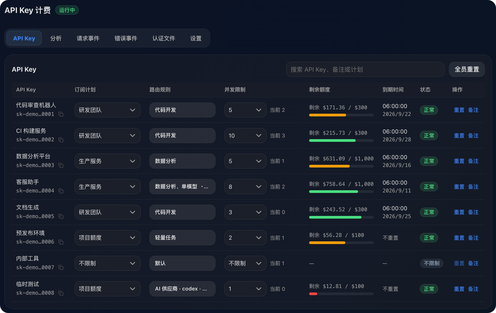

<div align="center">
  <h1>CPA Key Billing</h1>
  <p><strong>Per-key billing, subscription quotas, and routing for <a href="https://github.com/router-for-me/CLIProxyAPI">CLIProxyAPI</a>.</strong></p>
  <p>
    <a href="https://github.com/haowang02/cpa-plugin-key-billing/releases/latest"></a>
    <a href="https://github.com/haowang02/cpa-plugin-key-billing/releases"></a>
    
    <a href="./LICENSE"></a>
  </p>
  <p><strong>English</strong> · <a href="./README.md">简体中文</a></p>
</div>


## Features

- Limit spending, tokens, requests, and concurrency per API key, or share quotas across keys
- Use USD or CNY pricing, long-context tiers, and reference prices from [models.dev](https://models.dev/)
- Control model and upstream credential access through routing rules
- Admin and self-service dashboards with separate usage statistics for each key

## Installation

Requires **CLIProxyAPI 7.3.7 or later** with plugin support. Builds labeled `no-plugin` are not supported.

Search for `cpa-key-billing` in the CPAMC or CPAMP plugin store, or run the installer from your CLIProxyAPI directory.

macOS / Linux:

```sh
curl -LsSf https://raw.githubusercontent.com/haowang02/cpa-plugin-key-billing/main/install.sh | sh
```

Windows: stop CLIProxyAPI first, then run in PowerShell:

```powershell
irm https://raw.githubusercontent.com/haowang02/cpa-plugin-key-billing/main/install.ps1 | iex
```

The installer places the plugin in `plugins/` under the current directory.

## Configuration

Add the following to your CLIProxyAPI configuration:

```yaml
plugins:
  enabled: true
  dir: "plugins"
  configs:
    cpa-key-billing:
      enabled: true
      priority: 100 # Scheduling priority; higher values take precedence
      state_file: "plugins/cpa-key-billing-state-v1.db"
      debug: false # Debug logging
      codex_fast_mode_billing: false # Charge 2.5× for Codex priority requests
      allow_unpriced_models: false # Admit unpriced models and record usage at zero cost
      cny_per_usd: 7 # CNY per USD
      request_event_retention_days: 365 # History retention in days; shortening deletes older records
      mask_api_key_view_emails: false # Mask email addresses in API key account views
      allow_api_key_quota_reset: false # Let users reset accessible Codex / Claude auth file quotas using upstream resets
      routing:
        strategy: "round-robin" # round-robin, weighted-round-robin, fill-first
        session-affinity: false # Reuse an available credential for the same session
        session-affinity-ttl: "1h" # Idle timeout for session bindings
```

`routing` applies only to requests with credential restrictions; CPA schedules other requests.

Restart CLIProxyAPI after installing or upgrading.

> [!WARNING]
> Back up `state_file` before upgrading. Databases from v1.0.0 onward migrate automatically. Data from v0.8.4 or earlier is incompatible; use a new data file.

## Access

Open the plugin from the management panel or visit:

```text
http(s)://<CLIProxyAPI address>/v0/resource/plugins/cpa-key-billing/ui
```

## Billing and quotas

### Model pricing

Custom prices override reference prices; unpriced models are rejected by default. Quota usage is converted into the plan's currency at the configured exchange rate. Historical amounts retain their original currency.

### Subscription plans

A plan can have multiple quota windows combining spending, token, and request limits. Keys without a plan have no subscription quota limit.

| Type | Quota allocation | Reset schedule |
| --- | --- | --- |
| Per-key schedule | Separate quota for each key | Starts with each key's first admitted request |
| Shared schedule | Separate quota for each key | All keys reset at the configured time |
| Shared quota | One pool for all bound keys | All keys reset at the configured time |

Clearing history does not reset quotas. Unbinding or deleting a member key does not refund shared quota usage.

## Routing rules

- Bound rules and direct settings are combined: allowlists are merged, and denials take precedence. An empty allowlist permits everything except explicit denials.
- Credential category rules automatically cover future additions.

On **CLIProxyAPI 8.0.37 or later**, client model lists are filtered by routing permissions. Older versions show the full list, but access checks still apply to requests.

## Rejected requests

| Status | What to check |
| --- | --- |
| `403` | Whether the key's routing rules allow the model |
| `429` | Whether subscription quota or concurrency limits have been reached |
| `503` | Whether the model is priced and allowed credentials are available; check plugin logs for details |

## Acknowledgments

- [LINUX DO](https://linux.do/) community
