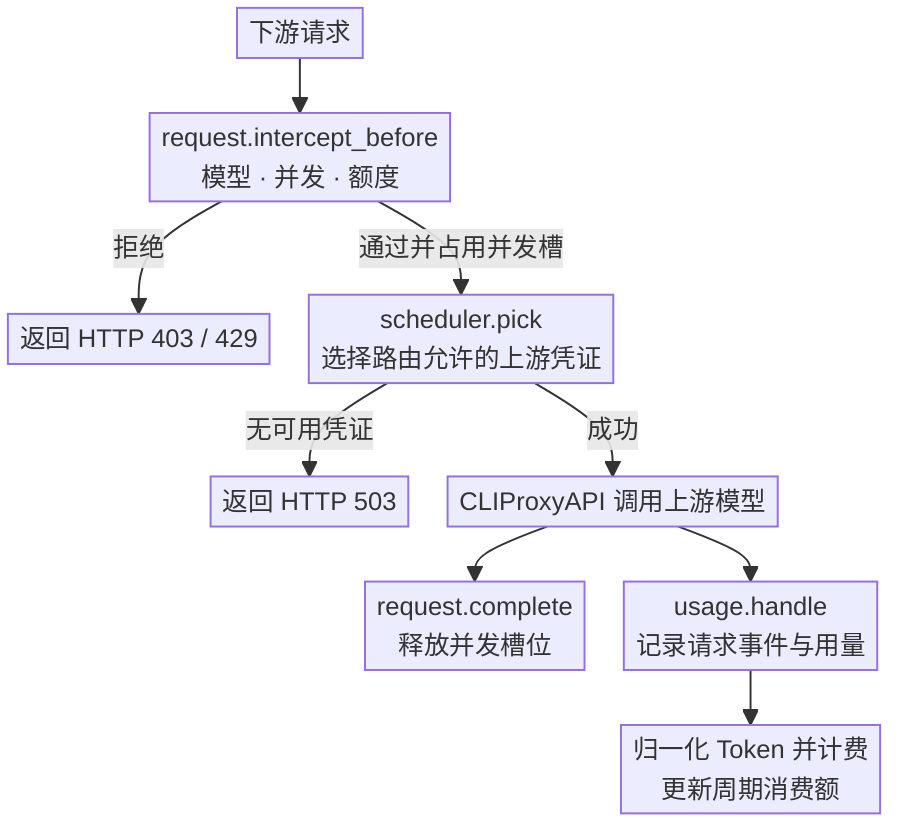
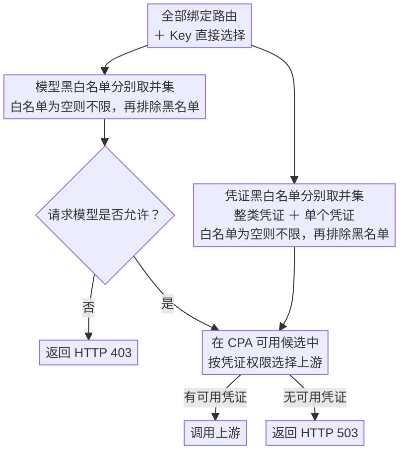

<div align="center">
  <h1>CPA Key Billing</h1>
  <p><strong><a href="https://github.com/router-for-me/CLIProxyAPI">CLIProxyAPI</a> 下游 API Key 计费与订阅额度插件。</strong></p>
  <p>
    <a href="https://github.com/haowang02/cpa-plugin-key-billing/releases/latest"></a>
    <a href="https://github.com/haowang02/cpa-plugin-key-billing/actions/workflows/check.yml"></a>
    
    <a href="./LICENSE"></a>
  </p>
  <p><a href="./README.en.md">English</a> · <strong>简体中文</strong></p>
</div>


## 功能特性

- 支持金额、Token、请求三种额度，可按 API Key 独立计时或按订阅计划统一周期重置
- 模型定价和订阅计划可分别使用美元或人民币计价，统计页面可按任一币种显示
- 支持按输入 Token 阈值切换长上下文**阶梯计价**
- 支持按 API Key 设置**最大并发请求数**
- 支持为每个 API Key 绑定**路由规则**，限制模型访问范围和上游凭证
- 可从 [models.dev](https://models.dev/) 获取模型参考价

## 工作原理

插件会在请求到达上游前检查订阅额度、并发和路由。上游调用结束后，CLIProxyAPI 通过 `usage.handle` 提供用量。插件据此记录请求事件、计算费用并更新周期消费额。



## 环境要求

- CLIProxyAPI `7.3.7` 或更高版本，建议使用最新版本；[按路由规则过滤模型列表](#模型列表)需要 `8.0.37` 或更高版本
- 使用支持插件的 CLIProxyAPI 构建，不要使用 no-plugin 版本

## 安装

### 商店安装

CPA 管理面板（CPAMC 或 CPAMP）插件商店搜索 `cpa-key-billing`。

### 人工安装

在 CLIProxyAPI 根目录运行。macOS 和 Linux 使用：

```sh
curl -LsSf https://raw.githubusercontent.com/haowang02/cpa-plugin-key-billing/main/install.sh | sh
```

Windows 请先停止 CLIProxyAPI，再在 PowerShell 中运行：

```powershell
irm https://raw.githubusercontent.com/haowang02/cpa-plugin-key-billing/main/install.ps1 | iex
```

安装脚本会将插件安装到当前目录的 `plugins/`。安装或升级完成后需要重启 CLIProxyAPI。

在 CLIProxyAPI 配置文件中加入：

```yaml
plugins:
  enabled: true
  dir: "plugins"
  configs:
    cpa-key-billing:
      enabled: true
      priority: 100 # 插件调度优先级，数值越大越优先
      debug: false # 是否记录 debug 日志，例如路由日志、匹配参考价日志
      codex_fast_mode_billing: false # 开启后，Codex 的 priority 请求按 2.5 倍计费
      allow_unpriced_models: false # 放行未定价模型的请求，用量按 0 费用记录
      cny_per_usd: 7 # 汇率：1 美元兑换的人民币数，用于换算不同币种的金额
      mask_api_key_view_emails: false # 对 API Key 查询页面返回的邮箱进行掩码脱敏
      allow_api_key_quota_reset: false # 允许 API Key 用户重置可访问的 Codex 和 Claude 认证文件额度，消耗上游重置次数
      state_file: "plugins/cpa-key-billing-state-v1.db"
      routing:
        strategy: "round-robin" # round-robin、weighted-round-robin、fill-first
        session-affinity: false # 同一会话优先复用可用的上游凭证
        session-affinity-ttl: "1h" # 会话绑定的空闲过期时间
```

路由规则对上游凭证设有限制时，插件按上述 `routing` 配置调度；其他请求由 CPA 调度。插件配置与 CPA 的全局调度配置相互独立。

CPA 按插件优先级选择调度插件，不会依次调用。建议显式设置 `priority: 100`，使本插件优先参与调度；省略时使用 CPA 的默认值 `0`。无论由谁调度，所选凭证都必须符合 API Key 的路由规则；凭证不符合规则或无法完成校验时，请求返回 `503`，原因记录在插件日志中。

首次调度或会话绑定失效时，插件按配置的策略，从优先级最高的可用凭证中选择。启用会话粘性后，同一会话优先复用已绑定的凭证；凭证不可用或会话空闲时间超过 `session-affinity-ttl` 后，重新选择凭证。会话标识由 CPA 提供，没有会话标识的请求按常规策略调度。

> [!WARNING]
> 升级前请备份数据文件。
>
> - v1.0.0 至最新版本的数据库文件支持自动迁移。
> - v0.8.4 及更早版本的 JSON 或 SQLite 数据文件不支持迁移，请将 `state_file` 指向新文件。

重启 CLIProxyAPI 后，在管理中心打开「CPA Key Billing」。确认模型定价后，创建订阅计划并绑定需要限制的 API Key。

## 页面访问

管理员可以从 CLIProxyAPI 管理中心的「CPA Key Billing」菜单进入，也可以直接打开：

```text
http(s)://<CLIProxyAPI 地址>/v0/resource/plugins/cpa-key-billing/ui
```

普通用户使用自己的 API Key 查询订阅额度和用量时，直接打开：

```text
http(s)://<CLIProxyAPI 地址>/v0/resource/plugins/cpa-key-billing/ui#account
```

## 计费与订阅规则

- 未绑定订阅计划的 API Key 只统计用量，不限制额度。
- 订阅计划可设置多个自定义额度窗口，每个窗口可单独或组合限制金额、Token、请求数。
- 每个 API Key 独立记账。独立周期从首次放行开始；统一周期可为各窗口指定下次开始时间，所有绑定 Key 按固定时间重置。
- 手动重置额度时，统一周期的重置时间保持不变；独立周期在下一次放行时重新开始。
- 自定义价优先于 models.dev 参考价。没有任何可用价格时拒绝新请求；开启 `allow_unpriced_models` 后放行，用量照常记录，费用为 0，其他额度和路由限制不变。
- 自定义价和订阅计划各自选择美元或人民币，内置价和参考价为美元。每笔请求按所用价格的币种记账；订阅额度按计划币种扣减，其他币种的消费按 `cny_per_usd` 换算。修改汇率或计划币种不会改写已记录的金额，额度用量按当前汇率重新换算。
- 分析、请求事件、认证文件和 AI 提供商页面可选择显示币种。默认的“自适应”使每项统计保留其消费的币种，混合多种币种时按美元显示。
- 请求事件保留最近 365 天。

## 路由规则

在 API Key 页面绑定路由规则，也可直接选择模型、整类凭证或单个凭证。点击模型或凭证的选框，可在未选择、白名单（勾号）、黑名单（叉号）之间切换。整类凭证包含该类别后续新增的凭证，也可用黑名单排除其中的单个凭证。模型与凭证分别合并所有绑定规则和直接选择：白名单取并集，黑名单取并集，黑名单优先。白名单为空时允许全部，再排除黑名单。



### 模型列表

使用 CLIProxyAPI `8.0.37` 或更高版本时，API Key 获取的模型列表只包含路由规则允许、且有允许的凭证提供的模型，客户端不会再显示无法调用的模型。旧版本 CLIProxyAPI 仍返回完整的模型列表。

## 拦截请求的响应

| 场景 | 状态码 | `type` | `code` |
| --- | --- | --- | --- |
| API Key 并发已满 | `429` | `rate_limit_error` | `rate_limit_exceeded` |
| 订阅额度用尽 | `429` | `rate_limit_error` | `rate_limit_exceeded` |
| 模型无权访问 | `403` | `permission_error` | `insufficient_quota` |
| 路由规则允许的凭证都不提供该模型，或当前都不可用 | `503` | `server_error` | `internal_server_error` |
| 选中的凭证不符合路由规则 | `503` | `server_error` | `routing_credential_mismatch` |
| 无法校验所选凭证的路由权限 | `503` | `server_error` | `routing_credential_unverified` |
| 模型未定价且未开启 `allow_unpriced_models` | `503` | `cpa_key_billing_error` | `model_price_error` |

## 致谢

- [LINUX DO](https://linux.do/) - 新的理想型社区
